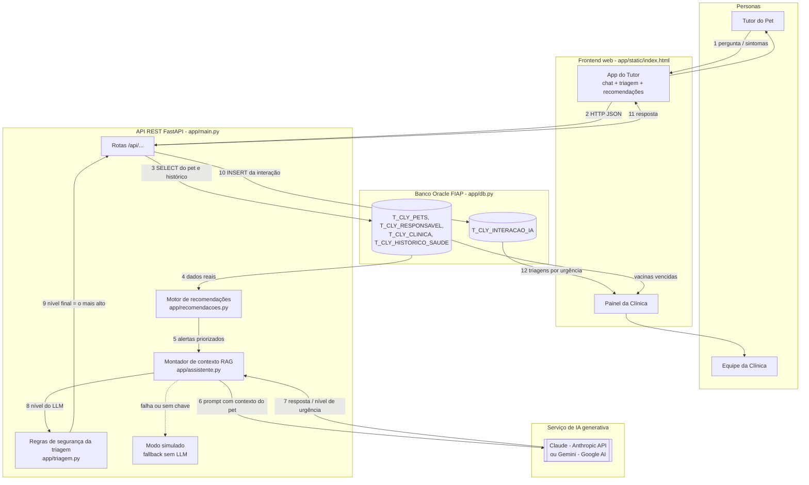
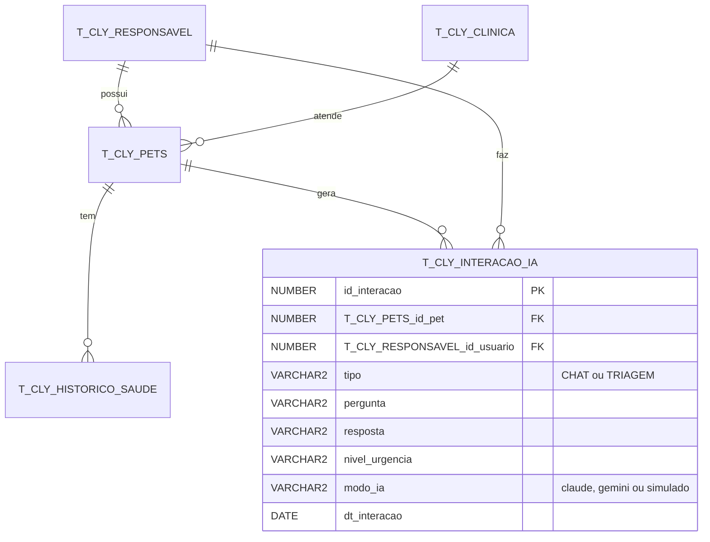

# Arquitetura de Integração — Assistente Inteligente CLYVO (Sprint 4)

Arquitetura **implementada**: o que estava proposto na Sprint 3 agora roda de verdade. Cada caixa do diagrama corresponde a um arquivo do repositório.

## Fluxo passo a passo

| Nº | Etapa | Onde no código |
|---|---|---|
| 1-2 | O tutor escolhe o pet e envia uma pergunta ou os sintomas. A tela faz `POST /api/chat` ou `POST /api/triagem` | `index.html`, `main.py` |
| 3-4 | **Retrieval:** a API busca no Oracle o perfil do pet, o tutor, a clínica e todo o histórico de saúde | `db.obter_pet`, `db.historico` |
| 5 | O motor de regras calcula a situação das vacinas, os check-ups atrasados, se o pet é idoso e os tratamentos em andamento | `recomendacoes.gerar` |
| 6 | **Augmented:** o contexto (dados + alertas + perfil do tutor) entra no prompt, com instruções para responder só com base nele | `assistente.montar_contexto` |
| 7 | **Generation:** o LLM gera a resposta em linguagem natural. Na triagem, devolve um JSON com nível, justificativa e orientação | `assistente.chamar_llm` |
| — | Se não houver chave ou a API falhar, o modo simulado responde com o mesmo contexto, e a aplicação não quebra | `assistente._resposta_simulada` |
| 8-9 | Na triagem, as palavras-chave de emergência funcionam como rede de segurança: vale o nível mais alto entre a regra e o LLM | `triagem.py` |
| 10 | A interação é gravada para auditoria e personalização | `db.salvar_interacao` |
| 11 | A resposta volta para a tela | `index.html` |
| 12 | O painel da clínica lista as triagens (ALTA primeiro) e os pets com vacina vencida | `assistente.alertas_clinica` |

## Modelo de dados usado pela IA

Reaproveita as tabelas do trabalho de Banco de Dados e acrescenta uma tabela nova:

